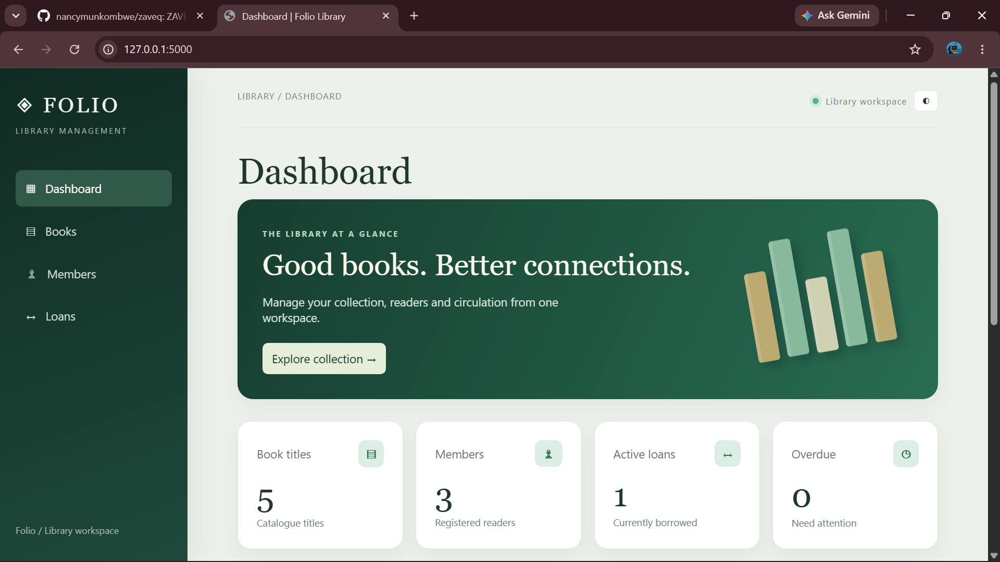
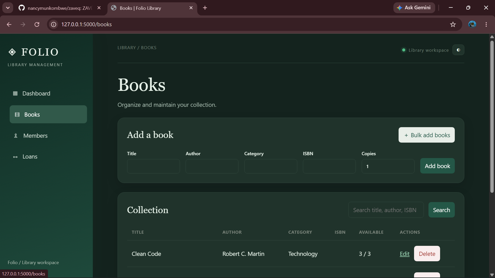
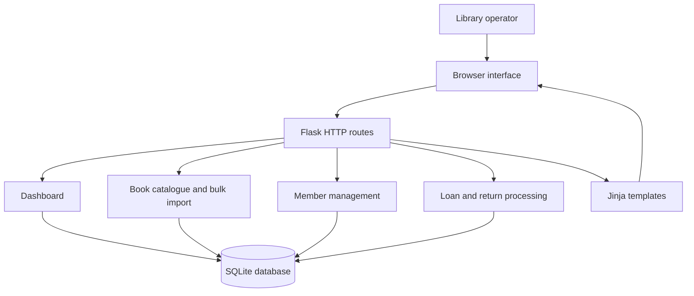
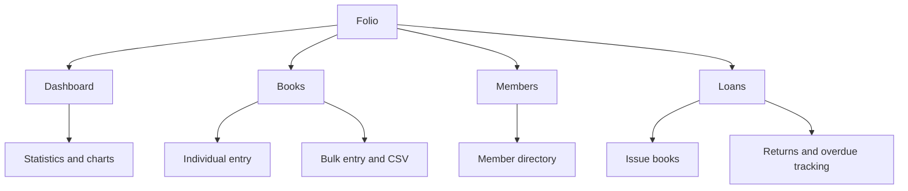
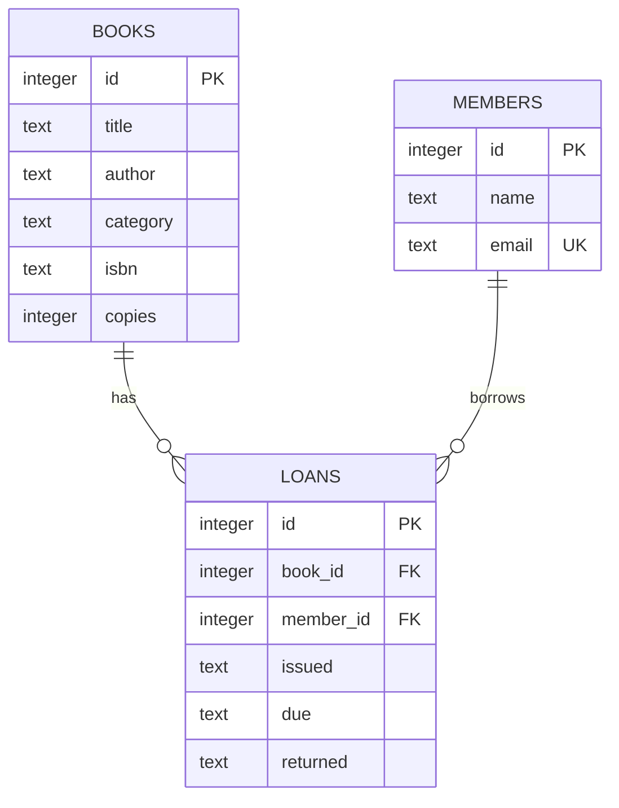

<div align="center">

# ◈ FOLIO

### Library Management, Reimagined.

A modern, full-stack library administration system built for organised collections, connected readers and effortless circulation.

**Discover. Organise. Connect.**


A


[Overview](#overview) • [Screenshots](#screenshots) • [Features](#features) • [Architecture](#system-architecture) • [Installation](#installation) • [Roadmap](#roadmap)

</div>

---

## Overview

Folio is a digital library management system designed to simplify the everyday administrative responsibilities of libraries. It brings book inventory, member registration, lending and returns into a single cohesive workspace.

The application combines a relational database with a motion-enhanced interface, interactive statistics and a custom visual identity. Bulk catalogue entry and CSV imports reduce repetitive work, while circulation tracking helps administrators understand which books are available, borrowed or overdue.

Folio is currently a locally hosted portfolio application and a foundation for future library digitalisation.

---

## Problem Statement

Libraries that rely on physical registers, spreadsheets and disconnected records may face duplicate entries, inaccurate stock counts, difficulty identifying overdue books and time-consuming catalogue updates.

Folio addresses these challenges through a centralised catalogue, structured member records and automated availability calculations.

## Project Objectives

- Digitise book inventory and library circulation.
- Streamline member registration and record management.
- Reduce repetitive data entry through batch operations.
- Improve visibility of book availability and overdue loans.
- Present operational information through an accessible dashboard.
- Establish a maintainable foundation for future cloud deployment.

---

## Screenshots

### Administrative Dashboard

A central workspace with animated statistics, circulation indicators and collection insights.



### Book Management

Search and manage the catalogue, add titles individually or in bulk, and monitor available copies.


### Member Management

Register readers and maintain a centralised member directory.


### Loan Management

Issue books, set due dates, record returns and review circulation history.


### Dark Mode

An alternative visual theme designed for comfortable use in low-light environments.



---

## Features

| Module | Capabilities |
|---|---|
| Dashboard | Animated counters, seven-day loan activity, category breakdown and recent circulation |
| Book catalogue | Add, edit, delete and search by title, author or ISBN |
| Bulk entry | Editable rows and CSV import, up to 500 entries per submission |
| Members | Registration, member directory and active loan counts |
| Circulation | Book issuing, due dates, returns, loan history and overdue status |
| Inventory | Automatic available-copy calculations and stock validation |
| Interface | Light and dark modes, entrance animations, hover effects and responsive layout |
| Persistence | SQLite database with relational constraints |

### Bulk Catalogue Entry

Folio supports adding several titles in a single operation. Administrators can enter editable rows or import a CSV file using this format:

```csv
title,author,category,isbn,copies
Atomic Habits,James Clear,Self-development,,8
Things Fall Apart,Chinua Achebe,Fiction,,5
Clean Code,Robert C. Martin,Technology,,3
```

Open **Books → Bulk add books** to use this feature. A sample file is included as `sample-books.csv`. Each row creates a new catalogue entry; imports do not merge existing titles. Invalid batches are rejected without inserting partial records.

---

## Target Users

| User | Intended use |
|---|---|
| Librarian | Manage collections and circulation |
| Library assistant | Register members and issue or receive books |
| School library administrator | Maintain educational resource inventories |
| Community library coordinator | Organise shared reading collections |

These are intended use cases, not implemented permission roles.

---

## Technology Stack

| Layer | Technology | Purpose |
|---|---|---|
| Frontend | HTML5, Jinja2 | Server-rendered interface |
| Styling | CSS3 | Responsive layout, themes and motion |
| Interactivity | JavaScript | Dynamic rows, theme switching and animations |
| Backend | Python, Flask | HTTP routes and application logic |
| Database | SQLite | Persistent relational data |
| Testing | unittest | Automated application tests |
| Development | Git, GitHub, VS Code | Version control and development workflow |

## Brand Identity

Folio combines editorial typography with a modern administrative interface inspired by the warmth and quiet of a library.

| Colour | Purpose |
|---|---|
| Forest green | Primary branding and navigation |
| Sage green | Interactive elements and highlights |
| Cream | Light-mode backgrounds |
| Charcoal | Dark-mode surfaces |

**Brand:** Folio  
**Tagline:** Library Management, Reimagined.  
**Core values:** Discover. Organise. Connect.

---

## System Architecture



Folio uses a server-rendered architecture. Flask handles requests and business rules, Jinja generates HTML views, and SQLite stores application records. JavaScript adds client-side interactions without requiring a separate frontend server.

## Application Modules



## Database Architecture



Available copies are calculated by subtracting active loans from the total number of copies. Loan records connect members to books and preserve historical circulation information. Books and members referenced by loan history cannot be deleted.

---

## Project Structure

```text
library-management-system/
├── app.py                # Flask routes and database logic
├── requirements.txt      # Python dependencies
├── sample-books.csv      # Example bulk import
├── templates/            # Jinja HTML views
├── static/
│   ├── style.css         # Design, themes and animations
│   └── app.js            # Client-side interactions
├── tests/
│   └── test_app.py       # Automated tests
├── screenshots/          # Portfolio screenshots
├── .gitignore
├── LICENSE
└── README.md
```

The local `library.db` file is generated automatically and should remain outside version control.

---

## Installation

### Prerequisites

Python 3, Git and a web browser. Visual Studio Code is optional. A separate database server is not required.

### 1. Clone the repository

```bash
git clone https://github.com/nancymunkombwe/library-management-system.git
cd library-management-system
```

### 2. Create a virtual environment (Windows PowerShell)

```powershell
py -m venv .venv
```

### 3. Install dependencies

```powershell
.\.venv\Scripts\python.exe -m pip install -r requirements.txt
```

### 4. Start the application

```powershell
.\.venv\Scripts\python.exe app.py
```

Open **http://127.0.0.1:5000** in your browser.

On macOS or Linux:

```bash
python3 -m venv .venv
.venv/bin/python -m pip install -r requirements.txt
.venv/bin/python app.py
```

### 5. Run automated tests

```powershell
.\.venv\Scripts\python.exe -m unittest discover -s tests
```

---

## Security and Privacy

Folio is currently intended for local demonstration with fictional records. The current version does not implement authentication, access roles or CSRF protection. It should not be exposed to the public or used with real member information until these protections are implemented.

Keep `.env`, `.venv/`, local databases and confidential records out of GitHub. Use fictional or anonymised data in public screenshots. Production deployment will require secure configuration, HTTPS, backups and additional testing.

---

## Roadmap

### Phase 1 — Core Development

- [x] Administrative dashboard
- [x] Book catalogue and search
- [x] Member registration
- [x] Book issuing and returns
- [x] Overdue tracking
- [x] SQLite persistence

### Phase 2 — User Experience and Productivity

- [x] Custom Folio branding
- [x] Animated statistics and page transitions
- [x] Light and dark modes
- [x] Circulation and collection visualisations
- [x] Bulk catalogue entry
- [x] CSV import
- [x] Portfolio documentation

### Phase 3 — Library Expansion

- [ ] Administrator authentication
- [ ] Role-based permissions and CSRF protection
- [ ] ISBN barcode scanning
- [ ] Book reservations and renewals
- [ ] Member self-service portal
- [ ] Exportable circulation reports
- [ ] Overdue notifications

### Phase 4 — Cloud and Production

- [ ] Cloud database integration
- [ ] Production server configuration
- [ ] Secure public deployment
- [ ] Automated database backups
- [ ] Administrative audit logs
- [ ] Production security and accessibility testing

---

## Expected Impact

Folio aims to reduce manual paperwork, improve inventory visibility, simplify circulation and provide library administrators with more organised information. These are intended benefits rather than measured deployment outcomes.

## Project Vision

The long-term vision is to develop an accessible library management platform for schools, universities and community libraries, with secure cloud access and tools that encourage reading and responsible resource sharing.

## Academic and Technical Application

The project demonstrates full-stack development, relational database design, server-side rendering, form validation, transaction handling, responsive interface design, data visualisation and software testing.

## Project Status

Folio 2.0 is under active development. Core local library workflows and interface enhancements are implemented; production security and public hosting remain future work.

---

## Developer

**Nancy Munkombwe**  
University of Zambia

[GitHub Profile](https://github.com/nancymunkombwe)

## License

Released under the [MIT License](LICENSE).

---

<div align="center">

## ◈ FOLIO

### Library Management, Reimagined.

**Discover. Organise. Connect.**

Built for libraries. Designed for readers.

Designed and developed in Zambia.

© 2026 Folio

</div>
